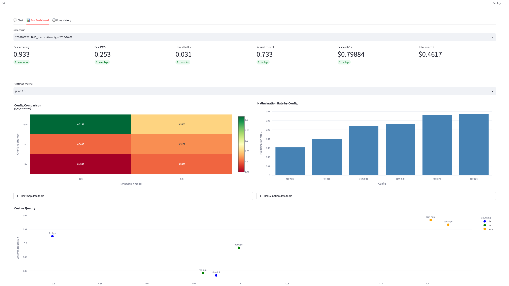
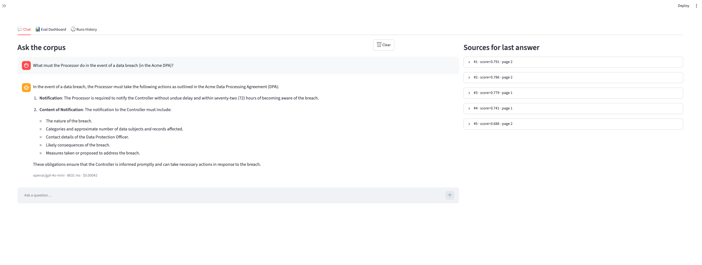

# Document Intelligence Platform

[](https://github.com/Vickkywhyte/doc-intelligence-platform/actions/workflows/ci.yml)
[]()
[]()
[]()

A RAG system over company documents that measures its own quality with a first-class evaluation pipeline comparing chunking strategies and embedding models.

---

## TL;DR

Everyone builds RAG. Almost nobody evaluates it. This is a benchmark harness
with a chat UI on top: it ingests company documents, answers questions with
citations, and measures answer accuracy, hallucination rate, retrieval
precision, and faithfulness across 6 chunking × embedding configurations.

---

## Results

Run `20261002T111815_matrix` — 75 golden questions, 6 configurations, $0.46 total.

| Chunking  | Embedding | Answer Acc ↑  | P@5 ↑         | MRR ↑         | Hallucination ↓ | Refusal ↑     | $/1k ↓        |
|-----------|-----------|---------------|---------------|---------------|-----------------|---------------|---------------|
| fixed     | BGE-small | 0.910         | 0.220         | 0.596         | **0.040**       | **0.733**     | **0.799**     |
| fixed     | MiniLM    | 0.853         | 0.197         | 0.575         | 0.066           | 0.533         | 0.974         |
| recursive | BGE-small | 0.893         | 0.217         | 0.636         | 0.068           | **0.733**     | 0.998         |
| recursive | MiniLM    | 0.857         | 0.203         | 0.593         | **0.031**       | 0.667         | 0.960         |
| semantic  | BGE-small | 0.927         | **0.253**     | **0.797**     | 0.054           | 0.667         | 1.222         |
| semantic  | MiniLM    | **0.933**     | 0.240         | 0.681         | 0.056           | **0.733**     | 1.203         |

**Key finding:** Semantic chunking wins on accuracy (0.933) and MRR (0.797),
justifying its ~1.5× cost premium over fixed chunking.

Lowest hallucination: recursive × MiniLM (0.031). Cheapest: fixed × BGE-small ($0.799/1k queries).

---

## Architecture

```
┌─────────────────────────────────────────────────────────────────────┐
│                            INTERFACES                                │
│                                                                      │
│  Streamlit UI  │    FastAPI    │  CLI scripts  │    Notebooks        │
│  (chat, eval,  │  (/query,     │  (01–06_.py)  │  (exploration)      │
│   runs tabs)   │   /eval)      │               │                     │
└─────────┬──────┴───────┬───────┴───────┬───────┴──────────┬──────────┘
          │              │               │                  │
          ▼              ▼               ▼                  ▼
┌─────────────────────────────────────────────────────────────────────┐
│                        ORCHESTRATION LAYER                           │
│                                                                      │
│    rag_pipeline.py        experiment.py          evaluator.py        │
│    (Q → A + citations)    (matrix runner)        (metrics + judge)   │
└──────┬─────────────┬──────────────────┬──────────────────┬───────────┘
       │             │                  │                  │
       ▼             ▼                  ▼                  ▼
┌──────────┐  ┌───────────┐   ┌────────────┐   ┌────────────────┐
│Ingestion │  │ Chunking  │   │ Embeddings │   │  Evaluation    │
│          │  │           │   │            │   │                │
│ loader   │  │ fixed     │   │ bge        │   │ metrics/       │
│ cleaner  │  │ recursive │   │ minilm     │   │ judge          │
│ metadata │  │ semantic  │   │            │   │ report         │
└────┬─────┘  └─────┬─────┘   └─────┬──────┘   └────────┬───────┘
     │              │               │                   │
     └──────────────┴───────────────┴───────────────────┘
                                    ▼
┌─────────────────────────────────────────────────────────────────────┐
│                     PERSISTENCE / INFRA LAYER                        │
│                                                                      │
│  FileSystem (data/)  │  Chroma  │  Cost log (JSONL)  │  Cache       │
└─────────────────────────────────────────────────────────────────────┘
```

Full architecture in [`claude_chat/02_ARCHITECTURE.md`](claude_chat/02_ARCHITECTURE.md).

---

## Why this exists

Three questions determine whether a RAG system is deployable:

1. **Is the answer correct?**
2. **Did the model fabricate something?**
3. **Did it retrieve the right passage?**

Most RAG demos can't answer any of them. This one can, with numbers.

---

## Quick start

```bash
git clone <repo> && cd doc-intelligence-platform
cp .env.example .env          # add OPENROUTER_API_KEY
python3.11 -m venv .venv && source .venv/bin/activate
pip install -e ".[dev]"
make corpus ingest chunk embed index
make serve
# API:  http://localhost:8000/docs
# UI:   http://localhost:8501
```

Or with Docker:

```bash
docker compose up -d
# API: http://localhost:8000/docs
# UI:  http://localhost:8501
```

---

## The evaluation pipeline — the differentiator

**Hallucination** is defined as claims in the answer not entailed by any retrieved chunk
(claim decomposition + per-claim entailment check). It is a binary property per claim,
aggregated as a rate. A model that hedges but cites nothing is not hallucinating — it
may be unfaithful.

**Faithfulness** is distinct: the fraction of answer statements grounded in retrieved
context. It allows paraphrase; hallucination does not. A faithfulness of 1.0 with
hallucination > 0 means the model both cited and fabricated — the two metrics catch
different failure modes.

**Refusal** is a first-class outcome. 15 of 75 golden questions are unanswerable from
the corpus; `refusal_correctness` is reported alongside accuracy. A system that always
answers looks good on accuracy but fails on this metric. Cross-strategy gold chunk IDs
let retrieval metrics compare apples to apples across chunking strategies. 95% bootstrap
CIs on all aggregates; no claims below CI half-width.

See [`claude_chat/06_EVAL_SPEC.md`](claude_chat/06_EVAL_SPEC.md) for the full specification.

---

## Project structure

```
doc-intelligence-platform/
├── claude_chat/          # Planning docs — source of truth (16 files)
├── src/docintel/         # Library code
│   ├── ingestion/
│   ├── chunking/
│   ├── embeddings/
│   ├── vectorstore/
│   ├── retrieval/
│   ├── generation/
│   ├── pipeline/
│   ├── evaluation/
│   └── utils/
├── api/                  # FastAPI (/health, /ingest, /query, /eval/*)
├── ui/                   # Streamlit (Chat, Eval Dashboard, Runs History)
├── scripts/              # Numbered runnable entry points (00–08)
├── tests/                # Mirrors src/; 378 tests
├── configs/              # YAML configs
├── data/                 # Corpus, chunks, indexes, golden (gitignored)
├── results/              # Run artifacts, reports, figures (gitignored)
├── logs/                 # Structured logs + cost ledger (gitignored)
├── pyproject.toml
├── Makefile
└── docker-compose.yml
```

---

## Tech stack

Python 3.11 · FastAPI · Streamlit · Chroma · sentence-transformers ·
OpenRouter (gpt-4o-mini) · Pydantic v2 · structlog · plotly · pytest

---

## Documentation

Full planning docs live in `claude_chat/`. Reading order:

- [`claude_chat/00_START_HERE.md`](claude_chat/00_START_HERE.md) — orientation
- [`claude_chat/01_PRD.md`](claude_chat/01_PRD.md) — product requirements
- [`claude_chat/02_ARCHITECTURE.md`](claude_chat/02_ARCHITECTURE.md) — system design
- [`claude_chat/03_TECH_DECISIONS.md`](claude_chat/03_TECH_DECISIONS.md) — 14 ADRs
- [`claude_chat/04_ROADMAP.md`](claude_chat/04_ROADMAP.md) — 11 phases
- [`claude_chat/06_EVAL_SPEC.md`](claude_chat/06_EVAL_SPEC.md) — ⭐ the differentiator

---

## The 30-second pitch

> "I built a RAG system over company documents — but the interesting part is
> the evaluation layer. I compare 3 chunking strategies against 2 embedding
> models on a 75-question golden dataset. I defined hallucination and
> faithfulness as separate, testable metrics — hallucination is 'unsupported
> claims in the answer,' faithfulness is 'fraction of the answer grounded in
> retrieved context.' I include 15 unanswerable questions to measure refusal
> correctness. The whole matrix runs in one command, produces a heatmap and
> cost-vs-quality scatter, and every run is reproducible from a config hash.
> This is what separates a RAG demo from a RAG system."

---

## Screenshots




---

## License

MIT
